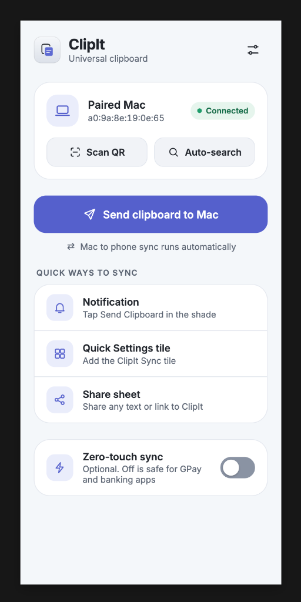
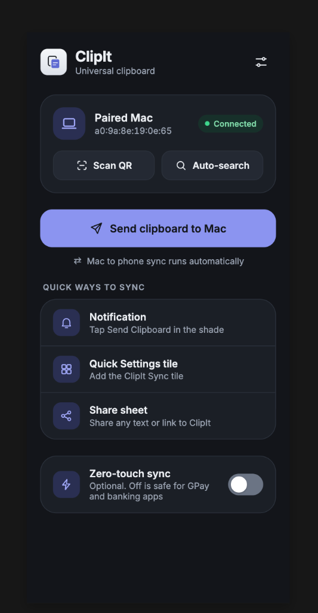

<p align="center">
  
</p>

<h1 align="center">ClipIt</h1>

<p align="center">
  <strong>Universal peer-to-peer clipboard synchronization between macOS and Android over Bluetooth Low Energy.</strong>
</p>

<p align="center">
  Zero Cloud &bull; No Wi-Fi Dependency &bull; Native Swift &bull; Modern Jetpack Compose
</p>

<br />

<p align="center">
  
  &nbsp;&nbsp;&nbsp;&nbsp;
  
</p>

---

## Overview

**ClipIt** provides seamless, peer-to-peer clipboard continuity between your Mac and Android phone using direct Bluetooth Low Energy (BLE). It operates entirely offline without intermediate cloud servers, web accounts, or shared Wi-Fi networks.

- **Direct Hardware Peer-to-Peer:** Operates anywhere, even with Wi-Fi disabled or while traveling.
- **Bi-Directional Instant Sync:** Copies on Mac are immediately available on Android, and phone clips transfer back to Mac in milliseconds.
- **Native macOS Menu Bar App:** Built in pure Swift with AppKit and CoreBluetooth. Runs unobtrusively in your status bar with Launch at Login support.
- **Modern Android App:** Built in Kotlin and Jetpack Compose with edge-to-edge transparency, adaptive theming (Light and Dark mode), and auto-reconnect.

---

## Key Features

- **One-Time Pairing:** Pair quickly via on-screen QR Code scanning (`Cmd + P` on Mac) or direct low-latency BLE discovery.
- **Auto-Reconnect Engine:** Automatically resumes synchronization whenever your Mac and phone come within range.
- **Loop & Echo Prevention:** 5-byte chunked framing protocol with SHA-256 digest validation prevents infinite clipboard loops.
- **Banking & UPI Safe:** Does not require accessibility permissions to operate. Quick Settings tile and ongoing notification actions ensure full compatibility with Google Pay, PhonePe, and banking apps.
- **Launch at Login:** Native macOS `SMAppService` integration allows the Mac companion to start silently on boot.

---

## Architecture

```
┌─────────────────────────────────┐                 ┌────────────────────────────────┐
│            macOS                │                 │            Android             │
│   (Menu Bar Application)        │                 │       (Kotlin / Compose)       │
├─────────────────────────────────┤                 ├────────────────────────────────┤
│ • CoreBluetooth Peripheral      │   Direct BLE    │ • BLE GATT Central Client      │
│ • Advertises ClipIt Service     │ <─────────────> │ • CompanionDeviceManager       │
│ • NSPasteboard Monitor          │  Notifications  │ • Quick Settings Tile          │
│ • Chunking & Framing Protocol   │    & Writes     │ • Foreground Service           │
│ • Echo Prevention Engine        │                 │ • 1-Tap Focus Activity         │
└─────────────────────────────────┘                 └────────────────────────────────┘
```

---

## Downloads & Pre-Built Releases

Pre-compiled packages are available in the [`release/`](release) directory and under the GitHub Releases tab:

| Platform | File | Description |
| :--- | :--- | :--- |
| **macOS** | [`ClipIt-macOS.dmg`](release/ClipIt-macOS.dmg) | Apple Disk Image installer. Open and drag to `/Applications`. |
| **macOS** | [`ClipIt-macOS.zip`](release/ClipIt-macOS.zip) | Standalone compressed application bundle. |
| **Android** | [`ClipIt.apk`](release/ClipIt.apk) | Production-ready Android APK (supports Android 8.0 through 14+). |

---

## Getting Started

### macOS Installation

1. Download [`ClipIt-macOS.dmg`](release/ClipIt-macOS.dmg), open it, and drag **ClipIt** to your **Applications** folder.
2. Launch ClipIt from **Spotlight** (`Cmd + Space` &rarr; type `ClipIt`) or your Applications folder.
3. Grant Bluetooth permissions when prompted.
4. *(Optional)* Click the ClipIt menu bar icon and check **Launch at Login** to have the app start automatically on boot.

#### Building from Source (macOS)
```bash
git clone https://github.com/adarsh-kutriyar/ClipIt-Universal-Clipboard.git
cd ClipIt-Universal-Clipboard/mac
./build_app.sh
```

---

### Android Installation

1. Download and install [`ClipIt.apk`](release/ClipIt.apk) on your Android device.
2. Open **ClipIt** and grant nearby device (Bluetooth) and notification permissions.
3. Tap **Scan QR** and point your camera at your Mac's pairing QR code (`Cmd + P` from the Mac menu bar icon).
4. Your devices are now paired.

#### Building from Source (Android)
```bash
git clone https://github.com/adarsh-kutriyar/ClipIt-Universal-Clipboard.git
cd ClipIt-Universal-Clipboard/android
./gradlew assembleDebug
adb install -r app/build/outputs/apk/debug/app-debug.apk
```

---

## Android Background Clipboard Handling

Starting with Android 10 (API 29), background clipboard reading is strictly protected by the Android framework. ClipIt accommodates this through dedicated native workflows:

### Mac to Android (Automatic)
Writing to the Android clipboard is fully supported by the operating system in the background. Whenever you copy text on your Mac, ClipIt transmits the text over BLE, and the Android foreground service immediately writes it to your phone's clipboard.

### Android to Mac (1-Tap & Safe)
To push clipboard content from your phone without triggering banking security alerts:

1. **Notification Shade:** Pull down your notification shade and tap **Send Clipboard**.
2. **Quick Settings Tile:** Add the **ClipIt Sync** tile to your quick toggles for instant access from any screen.
3. **Share Sheet:** Tap **Share** on any selected text or link in any application and select **ClipIt**.
4. **Zero-Touch Sync (Optional):** An optional accessibility service is available for hands-free background copying. Note that certain banking and UPI applications (such as Google Pay) may ask to pause accessibility tools for security.

---

## Technical Protocol Specification

- **Service UUID:** `8D4F0001-3A5B-4C6D-9E8F-1B2C3D4E5F60`
- **Clipboard Characteristic UUID:** `8D4F0002-3A5B-4C6D-9E8F-1B2C3D4E5F60` (`READ`, `WRITE`, `NOTIFY`)
- **CCCD Descriptor:** `00002902-0000-1000-8000-00805F9B34FB`
- **Advertised Local Name:** `ClipIt-Mac`

### Framing & Chunking Protocol
To support copying arbitrary text lengths (from single characters to long articles and code blocks) beyond BLE MTU boundaries, all payloads are transmitted with a 5-byte header:

```
[Byte 0: MessageID (1B)] [Bytes 1-2: TotalChunks (2B, BE)] [Bytes 3-4: ChunkIndex (2B, BE)] [Payload: UTF-8 Bytes]
```

---

## License

This project is released under the [MIT License](LICENSE).
